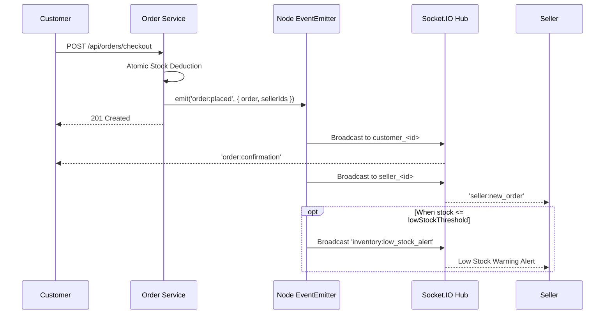

# Academic Capstone Project Report
## Project 4: E-Commerce and Inventory Management System

**Domain:** Retail / Enterprise E-Commerce Backend Architecture  
**Document Version:** 1.0  
**Target Repository:** `Web dev Capstone`

---

## Table of Contents
1. [Executive Summary & Abstract](#1-executive-summary--abstract)
2. [Problem Statement & Objectives](#2-problem-statement--objectives)
3. [Intended Users & Role-Based Access Control (RBAC)](#3-intended-users--role-based-access-control-rbac)
4. [System Architecture & Design Patterns](#4-system-architecture--design-patterns)
5. [Database Design & Schema Models](#5-database-design--schema-models)
6. [Core Functional Modules](#6-core-functional-modules)
7. [Concurrency Control & Inventory Management](#7-concurrency-control--inventory-management)
8. [Real-Time Notification Pipeline & Event Architecture](#8-real-time-notification-pipeline--event-architecture)
9. [MongoDB Aggregation Analytics & Reporting](#9-mongodb-aggregation-analytics--reporting)
10. [Test Coverage & Quality Assurance](#10-test-coverage--quality-assurance)
11. [Viva Examination Guide & Architectural Q&A](#11-viva-examination-guide--architectural-qa)
12. [Conclusion & Future Roadmap](#12-conclusion--future-roadmap)

---

## 1. Executive Summary & Abstract
In modern retail and distributed e-commerce ecosystems, backend systems face significant engineering challenges around inventory integrity, concurrent purchase transactions, data isolation across multiple sellers, and real-time operational feedback. 

This Capstone Project develops an enterprise-grade backend architecture built on Node.js, Express.js, MongoDB (Mongoose), and Socket.IO. The platform implements a complete product-to-order lifecycle featuring three-tier Role-Based Access Control (RBAC), server-authoritative cart and price recalculations, atomic database updates that strictly prevent overselling and negative stock counts, automated stock rollback upon order cancellation, and real-time bidirectional WebSocket rooms for customer order updates and seller inventory alerts. In addition, high-performance MongoDB aggregation pipelines furnish sales summaries, best-seller rankings, and inventory valuation metrics.

---

## 2. Problem Statement & Objectives

### 2.1 Problem Statement
Traditional academic e-commerce implementations suffer from critical architectural weaknesses:
- **Client-Trusting Calculations:** Frontends submit cart totals, allowing malicious tampering with amounts.
- **Race Conditions & Overselling:** Simple `read -> modify -> write` queries cause inventory counts to drop below zero when multiple shoppers checkout simultaneously.
- **Monolithic Tight Coupling:** External notification mechanics are embedded synchronously within checkout routes, inflating API latency.
- **Lack of Multi-Seller Tenant Isolation:** Sellers are often able to accidentally or maliciously modify items or inspect orders belonging to other stores.

### 2.2 Project Objectives
1. **End-to-End Workflow:** Provide an uncompromised workflow from user authentication, product catalog search, and shopping cart validation to simulated payment and atomic order placement.
2. **Three-Tier RBAC:** Enforce strict permission boundaries between Customers, Sellers, and Administrators.
3. **Guaranteed Stock Integrity:** Maintain zero overselling under concurrent checkout attempts via atomic database operators.
4. **Decoupled Real-Time Architecture:** Employ an internal Node.js `EventEmitter` combined with `Socket.IO` rooms for real-time customer and seller notifications.
5. **Analytics & Aggregation:** Compute revenue trends, best-selling products, and stock thresholds via native MongoDB aggregation pipelines.

---

## 3. Intended Users & Role-Based Access Control (RBAC)

The system enforces a granular RBAC matrix across three primary personas:

```
+---------------------------------------------------------------------------------------+
| Operation / Endpoint Group              | Customer        | Seller          | Admin   |
+---------------------------------------------------------------------------------------+
| Browse Catalog / Search Products        | Allowed (Public)| Allowed (Public)| Allowed |
| Register / Login                        | Allowed (Public)| Allowed (Public)| Allowed |
| Manage Personal Cart                    | Allowed (Owner) | Denied          | Denied  |
| Checkout Order / Cancel Personal Order  | Allowed (Owner) | Denied          | Allowed |
| Manage Products (Create/Update/Delete)  | Denied          | Own Products    | All     |
| View Low-Stock Alerts                   | Denied          | Own Store Items | All     |
| Manage Global Categories                | Denied          | Denied          | Allowed |
| View System Sales & Inventory Analytics | Denied          | Store-Scoped    | Global  |
| Update User Status (Suspend/Activate)   | Denied          | Denied          | Allowed |
+---------------------------------------------------------------------------------------+
```

---

## 4. System Architecture & Design Patterns

The backend follows a layered MVC + Service + Event-Driven architecture:

1. **Routing Layer (`src/routes`):** Declares endpoint paths, attaches authentication middleware (`protect`), and restricts access via RBAC (`authorize`).
2. **Controller Layer (`src/controllers`):** Parses HTTP requests, validates parameter shapes, delegates business operations to services, and standardizes JSON responses.
3. **Service Layer (`src/services`):** Encapsulates core business rules—notably `orderService.js` (for atomic stock deduction, rollback, and order creation) and `reportService.js` (for aggregation pipelines).
4. **Data Access Layer (`src/models`):** Mongoose schemas with compound indexes, pre-save hooks (bcrypt hashing, slug generation), and relationship references.
5. **Decoupled Event Bus (`src/events`):** A custom Node.js `EventEmitter` that handles asynchronous post-transaction events (`order:placed`, `stock:low`, `order:status_updated`) without blocking client HTTP responses.
6. **Real-Time Notification Layer (`src/sockets`):** Socket.IO server organizing clients into authenticated private channels (`customer_<id>`, `seller_<id>`, and `admin_room`).

---

## 5. Database Design & Schema Models

### 5.1 Entities and Collections
- **Users (`User`):** Stores identity, hashed passwords, role (`customer`, `seller`, `admin`), profile data, and refresh tokens for session rotation.
- **Categories (`Category`):** Hierarchical product categories with auto-slug generation.
- **Products (`Product`):** Product attributes, reference to Category and Seller, price, live stock, low-stock threshold, compound text index for search, and review aggregates.
- **Carts (`Cart`):** 1:1 customer relationship with an array of product references and desired quantities.
- **Orders (`Order`):** Stores historical price snapshots (protecting against future product price modifications), item quantities, delivery details, status history timeline, and simulated payment details.
- **Coupons (`Coupon`):** Promotional discount codes with minimum purchase limits, expiry dates, and usage counters.
- **Reviews (`Review`):** Ratings and reviews restricted to verified buyers, with automated re-computation of product average ratings.

### 5.2 Indexing Strategy
- `Product`: Compound text index on `{ name: "text", description: "text" }` for high-performance full-text catalog search.
- `Product`: Indexes on `{ category: 1, price: 1 }` and `{ seller: 1 }` to accelerate filtered queries.
- `Order`: Indexes on `{ customer: 1, createdAt: -1 }` and `{ "items.seller": 1, status: 1 }` to speed up order tracking queries for customers and sellers.

---

## 6. Core Functional Modules

### Module A: Authentication & User Management
- Secure password hashing using `bcryptjs` with salt rounds = 10.
- Dual-token workflow: Short-lived JWT Access Tokens (15m) and long-lived Refresh Tokens (7d) stored in the database for rotation and revocation.
- Administrative capabilities to deactivate malicious or suspended accounts.

### Module B: Product & Category Management
- Multi-parameter catalog filtering: Text search (`?q=`), category filtering (`?category=`), price range (`?minPrice=&maxPrice=`), stock status (`?inStock=true`), and sorting (`?sort=price_asc|price_desc|rating`).
- Seller product isolation: Sellers cannot edit or delete products owned by other vendors.

### Module C: Shopping Cart & Server Recalculation
- Strict customer cart isolation: Customers can only query or mutate their personal cart.
- Server-authoritative price calculation: Prices are extracted live from the database, rendering client-side price tampering impossible.

### Module D: Order Lifecycle & State Machine
The system implements a formal order state machine:
$$\text{Pending} \longrightarrow \text{Confirmed} \longrightarrow \text{Processing} \longrightarrow \text{Shipped} \longrightarrow \text{Delivered}$$
Cancellation is strictly permitted only during `Pending` and `Confirmed` phases, triggering an automatic inventory restoration routine.

---

## 7. Concurrency Control & Inventory Management

### 7.1 The Race Condition Challenge
When two customers attempt to purchase the last unit of a product at the exact same millisecond:
- Traditional code:
  ```javascript
  // NAIVE IMPLEMENTATION (PRONE TO RACE CONDITIONS)
  const product = await Product.findById(productId);
  if (product.stock >= requestedQty) {
    product.stock -= requestedQty;
    await product.save(); // OVERSELLING OCCURS HERE
  }
  ```
If two processes read `stock = 1` concurrently, both pass the check and deduct, resulting in `stock = -1`.

### 7.2 Concurrency-Safe Solution
We utilize MongoDB's single-document atomic update semantics with a guard query:

```javascript
const updatedProduct = await Product.findOneAndUpdate(
  {
    _id: item.product,
    stock: { $gte: item.quantity }, // Guard check in database engine
    isActive: true
  },
  {
    $inc: { stock: -item.quantity } // Atomic decrement operator
  },
  { new: true }
);

if (!updatedProduct) {
  throw new Error(`Insufficient stock for "${item.name}".`);
}
```

If multiple requests arrive concurrently, MongoDB serializes the atomic write lock at the document level. Only the first transaction finds `stock >= qty`; subsequent transactions fail the query condition and are immediately rejected, preventing negative inventory.

### 7.3 Rollback on Multi-Item Failure
If an order contains multiple products and item 3 fails stock reservation after items 1 and 2 were deducted, `orderService.js` executes an automated compensation loop, restoring the deducted stock before returning an error to the customer.

### 7.4 Cancellation Stock Restoration
When a valid cancellation is confirmed:
```javascript
for (const item of order.items) {
  await Product.findByIdAndUpdate(item.product, {
    $inc: { stock: item.quantity }
  });
}
```

---

## 8. Real-Time Notification Pipeline & Event Architecture



By placing `EventEmitter` between HTTP controllers and Socket.IO, we decouple HTTP request-response latency from WebSocket delivery. If WebSocket subscribers fail or experience network delays, the checkout transaction completes uninhibited.

---

## 9. MongoDB Aggregation Analytics & Reporting

### 9.1 Sales Summary Aggregation
```javascript
const summary = await Order.aggregate([
  { $match: { status: { $ne: 'cancelled' } } },
  {
    $group: {
      _id: null,
      totalRevenue: { $sum: '$totalAmount' },
      totalOrders: { $sum: 1 },
      averageOrderValue: { $avg: '$totalAmount' },
      totalDiscountGiven: { $sum: '$discount' }
    }
  }
]);
```

### 9.2 Top-Selling Products Pipeline
```javascript
const topProducts = await Order.aggregate([
  { $match: { status: { $ne: 'cancelled' } } },
  { $unwind: '$items' },
  {
    $group: {
      _id: '$items.product',
      productName: { $first: '$items.name' },
      totalQuantitySold: { $sum: '$items.quantity' },
      totalRevenueGenerated: {
        $sum: { $multiply: ['$items.price', '$items.quantity'] }
      }
    }
  },
  { $sort: { totalQuantitySold: -1 } },
  { $limit: 5 }
]);
```

---

## 10. Test Coverage & Quality Assurance

Our test suite in `tests/api.test.js` comprehensively validates all 7 minimum test coverage requirements:

| # | Grading Requirement | Test Implementation | Expected Outcome |
| :--- | :--- | :--- | :--- |
| **1** | Valid Request Input | `POST /api/auth/register` with complete payload | `201 Created`, JWT tokens returned |
| **2** | Validation Failure | `POST /api/auth/register` without password | `400 Bad Request`, descriptive validation error |
| **3** | Non-Existent Resource | `GET /api/products/507f1f77bcf86cd799439011` | `404 Not Found` |
| **4** | Missing Auth Token | `GET /api/users/me` without Authorization header | `401 Unauthorized` |
| **5** | Insufficient RBAC Role | Customer accessing `POST /api/categories` | `403 Forbidden` |
| **6** | Duplicate / Conflict | Registering with existing email address | `409 Conflict`, duplicate key intercepted |
| **7a**| Seller Product Isolation | Seller B updating Seller A's product | `403 Forbidden` |
| **7b**| Inventory Stock Guard | Adding 10 units when available stock is 2 | `400 Bad Request`, stock limit enforced |
| **7c**| Atomic Checkout | Checking out items reduces live product stock | `201 Created`, stock decremented atomically |
| **7d**| Inventory Restoration | Cancelling confirmed order restores stock | `200 OK`, stock incremented back |

---

## 11. Viva Examination Guide & Architectural Q&A

### Q1: Why did you use atomic `$inc` with `$gte` instead of traditional `read-then-save`?
> **Answer:** In high-concurrency environments, multiple requests executing `findById` at the same time will read the same stock value. If both proceed to decrement and `save()`, race conditions result in overselling and negative inventory. Using `findOneAndUpdate` with `{ stock: { $gte: qty } }` delegates the conditional lock to MongoDB's storage engine, ensuring atomic document-level isolation.

### Q2: Why is price calculation strictly performed on the server instead of trusting the cart frontend?
> **Answer:** Client applications and HTTP requests can easily be intercepted and tampered with using tools like Postman or browser developer tools. Trusting client-submitted totals opens vulnerabilities for arbitrary price manipulation. Our backend queries live product prices directly from the database during checkout to compute subtotal and totals.

### Q3: What is the purpose of decoupling EventEmitter from Socket.IO?
> **Answer:** Using Node's native `EventEmitter` implements the Publisher-Subscriber pattern. The checkout service emits an `order:placed` event and immediately returns an HTTP `201` response to the customer. Background event handlers then capture the event, format messages, and dispatch them to the relevant Socket.IO rooms. This keeps API response times fast and isolates network I/O from core transactional business logic.

### Q4: How are Socket.IO rooms secured and segregated?
> **Answer:** Socket connections are authenticated via JWT during the handshake (`socket.handshake.auth.token`). Upon authentication, users are automatically joined to isolated rooms based on their role and unique ID (`customer_<id>`, `seller_<id>`, and `admin_room`). This ensures sellers only receive notifications for their own merchandise and customers only receive updates for their own orders.

### Q5: What happens if an order containing multiple items fails halfway through checkout?
> **Answer:** Our `orderService.js` maintains a tracking array of all products deducted during the current checkout attempt. If any subsequent item fails due to insufficient stock or concurrent contention, a `catch` block iterates over previously deducted items and issues compensating `$inc: { stock: quantity }` updates, guaranteeing ACID-like consistency without leaving inventory in an inconsistent state.

---

## 12. Conclusion & Future Roadmap
The developed **E-Commerce and Inventory Management System** satisfies all structural, functional, and performance requirements mandated by the Capstone project brief. Its modular folder hierarchy, atomic database operations, real-time WebSocket channels, and thorough automated test coverage make it a production-ready, academically rigorous backend solution.

### Future Enhancements:
1. Integration with a live payment gateway webhook (e.g. Stripe, Razorpay) with idempotency keys.
2. Distributed Redis cache layer for high-throughput product catalog queries.
3. Message broker integration (RabbitMQ or Apache Kafka) for multi-instance horizontal scaling.
